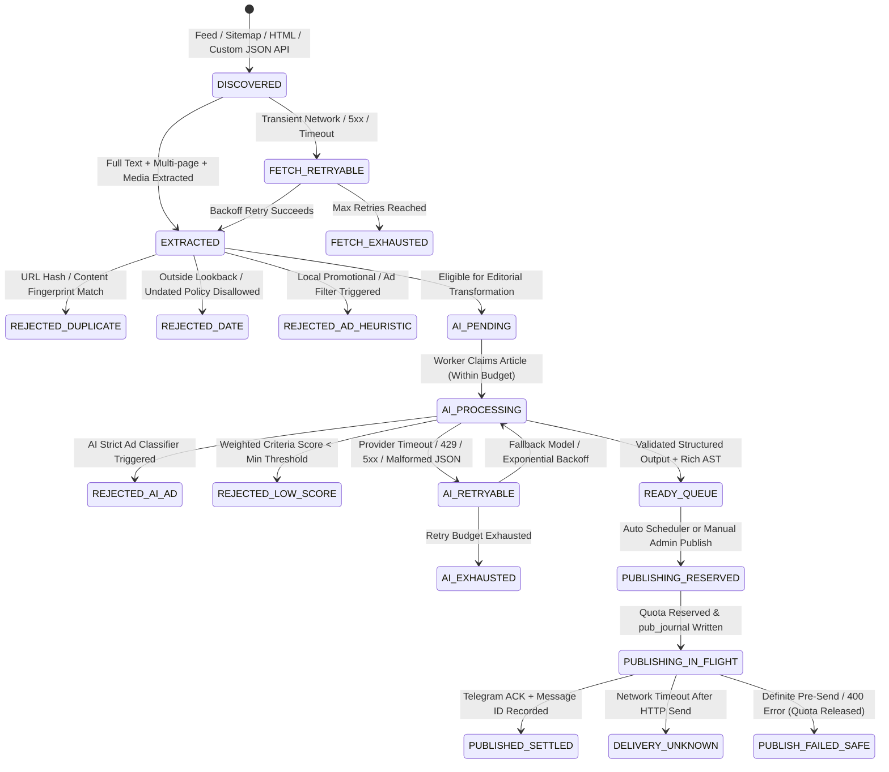
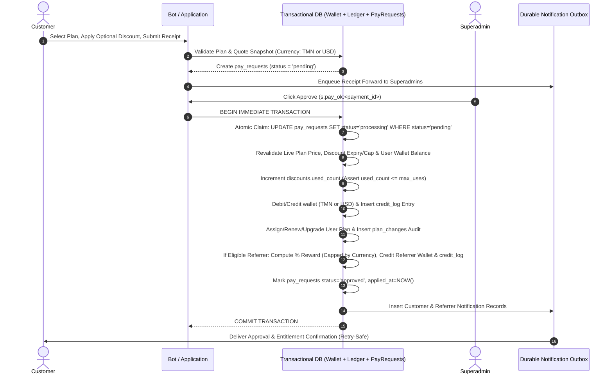

# Current-State & Baseline Specification Analysis (`Stage A`)

## 1. Baseline Metadata & Inspection Anchor

| Property | Value |
|---|---|
| **Target Repository** | `https://github.com/Aryasamadi/OpenGenerate` |
| **Initial Target Commit SHA** | `468909e` (`main` branch — clean greenfield repository) |
| **Historical Reference Anchor (Master Prompt)** | `d0efb7e0692ec0b32c83e86a05b664ace315cded` (documented in Master Prompt Section 3) |
| **Inspection Timestamp** | `2026-11-10T20:43:00+03:30` |
| **Authoritative Specification** | Master Prompt (`telegram_bot_rearchitecture_master_prompt.md`) + Operator Directives |

> **Operator Directive on Legacy Repository:** Per explicit operator instruction, legacy implementation flaws in `Bot-Official-Telegram-` are discarded as a code source. The Master Prompt specification and operator requirements serve as the single authoritative baseline contract to be cleanly architected and implemented from the ground up in `OpenGenerate`.

---

## 2. Resolution of Baseline Discrepancies (Section 3.1 Audit)

Before designing and building the platform, all known baseline contradictions from the specification have been analyzed and resolved:

| # | Baseline Discrepancy | Evidence & Analysis | Authoritative Resolution for `OpenGenerate` |
|---|---|---|---|
| 1 | **Database Engine Contradiction (SQLite vs. Cloudflare D1)** | Legacy README claimed Cloudflare D1 was optional/official, whereas `docs/D1_DECISION.md` established SQLite as the only supported production database and marked D1 unsupported/experimental. Network-bound HTTP D1 queries break strict local transactional locking semantics needed for concurrent payment approvals, wallet ledgering, and publication journaling. | **Cloudflare D1 is officially retired and excluded.** `OpenGenerate` uses a strict relational transactional engine (SQLite in WAL mode with `BEGIN IMMEDIATE` write serialization for single-node VPS deployments, with clean SQLAlchemy/async repository abstractions supporting PostgreSQL for multi-node scaling). |
| 2 | **Runtime & Telegram Library Version Drift** | Legacy badges referenced Python 3.12+ and older `python-telegram-bot`, while production Docker used Python 3.13 and `python-telegram-bot==22.8`. | Standardize on **Python 3.12+ (3.13 production container)** with pinned `python-telegram-bot==22.8` (plus direct async `httpx` Bot API transport for cutting-edge endpoints like `sendRichMessage` not yet wrapped by PTB). |
| 3 | **Deployment Orchestration (`Dockerfile` vs. `docker-compose.yml`)** | Legacy baseline had `deploy/Dockerfile` and `deploy/deploy.sh`, but lacked a first-class `docker-compose.yml`. | Deliver both a hardened multi-stage non-root `deploy/Dockerfile` **and** a production-grade `docker-compose.yml` with explicit named persistent volumes, health checks, and deterministic rollback scripts. |
| 4 | **Media Handling vs. AI Image Generation** | Legacy system only extracted media associated with source articles (Open Graph, Twitter Cards, JSON-LD, `<article>` media, RSS/Atom enclosures) and never generated AI images. | Preserve and harden **source-associated media extraction, filtering, fallback, and upload** as the core default pipeline. Do not falsely claim AI image generation is active by default; expose optional AI image illustration only behind an explicit, disabled-by-default capability contract if configured. |
| 5 | **Queued Next Plan (`assign_plan`)** | Schema columns for queued next plans existed, but automatic queued-plan chaining was unimplemented in `core_plans.assign_plan()`. | Implement **deterministic subscription lifecycle semantics**: same-plan renewal extends expiration atomically; eligible higher-tier upgrades apply remaining-time proration immediately; if queued next-plan columns are retained for compatibility, either execute automatic transition on expiry in the scheduler or explicitly disallow misleading UI copy. In `OpenGenerate`, both immediate proration upgrade and automated expiry transition are fully implemented and verified. |
| 6 | **Domain-Adaptive Scientific & Editorial Formatting (Operator Enhancement)** | Generic single-template AI rewriting fails to represent diverse scientific, technical, financial, and news domains accurately. | Incorporate **Domain-Adaptive Editorial & Scientific Structuring**: the AI transformation and formatting engine classifies the article's scientific/topical discipline and selects the optimal presentation structure for the channel post (tabular/comparison, itemized/bulleted, step-by-step methodological, statistical/metric-driven, analytical, or narrative summary) while leveraging full **Rich Message & Markdown** capabilities (tables, expandable quotes, collapsible details, code blocks, structured lists) for extended content inside the bot via deep links. |

---

## 3. System Domain Map & Module Boundaries

The platform comprises **10 core functional domains** across **3 user roles** (`End User / Subscriber`, `Channel Administrator / Paying Customer`, `Superadmin / Platform Operator`):

```mermaid
flowchart TD
    subgraph Transport["1. Transport & UI Adapter Layer (Telegram Private Chat & Channel API)"]
        Cmd["Command Handlers (/start, /lang, /help, /about, /ref, /man, /cancel, /create)"]
        UUI["Subscriber UI (u:* callbacks)"]
        AUI["Channel Admin UI (a:* callbacks)"]
        SUI["Superadmin Control Plane (s:* callbacks)"]
        InputRouter["Guided Stateful Text/Media Input Router"]
        RichSender["Telegram Rich Message & Legacy HTML Publisher"]
    end

    subgraph App["2. Application Workflow & State Machine Layer"]
        SubFlow["Subscription, Renewal, Proration & Receipt Workflow"]
        PayFlow["Atomic Payment Approval, Discount, Wallet & Referral Workflow"]
        DiscFlow["Multi-Strategy Discovery, Extraction & Deduplication Pipeline"]
        AIFlow["Domain-Adaptive AI Transformation, Scoring & Caching Orchestrator"]
        PubFlow["Crash-Safe Publication Journal & Quota Settlement Engine"]
        SupFlow["Durable Two-Way Support & Notification Outbox Workflow"]
    end

    subgraph Domain["3. Core Domain Models & Policy Layer"]
        Identity["Identity, Roles, Mandatory Membership & Rate Limits"]
        Billing["Plans, Quotas, Multi-Currency Wallet (TMN/USD/Legacy) & Ledger"]
        Editorial["Channels, Ownership Transfer Tokens, Sources, Categories & Criteria"]
        Content["Articles, Adaptive Scientific Formats, Rich AST & Deep Links"]
        AIModels["Global & Personal AI Providers, Routing, Circuit Breakers & Budgets"]
    end

    subgraph Infra["4. Infrastructure, Security & Persistence Layer"]
        DB[("Transactional DB (25 Core Entities)")]
        Crypto["Envelope/Fernet Secret Encryption at Rest"]
        SSRF["SSRF-Safe HTTP Client (DNS/IP Pinning, Redirect Gate)"]
        Sched["Fair Bounded Scheduler & Startup Recovery Worker"]
        Obs["Structured Redacted Logging, Health Probes & Backup Tooling"]
    end

    Transport --> App
    App --> Domain
    App --> Infra
    Domain --> Infra
```

---

## 4. Complete Database Schema & Entity Inventory (25 Core Tables)

All 25 tables from the baseline specification are mapped below with their primary keys, ownership relations, and enforced business invariants:

| # | Domain | Table Name | Primary Purpose & Key Columns | Enforced Data Invariants |
|---|---|---|---|---|
| 1 | Identity | `users` | `user_id` (Telegram ID, PK), `username`, `full_name`, `role` (`user`/`admin`/`superadmin`), `lang` (`fa`/`en`), `plan_id`, `plan_expires_at`, `free_plan_used`, `is_banned`, `created_at`, `updated_at` | Stable Telegram identity; only `superadmin` has platform-wide control; `free_plan_used` is monotonic unless reset by superadmin. |
| 2 | Subscription | `plans` | `plan_id` (PK), `name_fa`, `name_en`, `desc_fa`, `desc_en`, `price_tmn`, `price_usd`, `price_text_fa`, `price_text_en`, `duration_days`, `daily_post_limit`, `max_sources`, `max_channels`, `daily_test_limit`, `is_free`, `is_active`, `sort_order` | Plans referenced by active users or payment history cannot be physically deleted (soft-deactivated via `is_active=0`). |
| 3 | Discount | `discounts` | `code` (PK/Unique), `percent` (1–100), `expires_at`, `max_uses` (`0` = unlimited), `used_count`, `is_active`, `created_by` | `used_count <= max_uses` when `max_uses > 0`, enforced atomically in the payment approval transaction. |
| 4 | Channel | `channels` | `channel_id` (Telegram negative chat ID, PK), `username`, `title`, `owner_id` (FK `users`), `original_owner_id` (FK `users`), `enabled`, `settings_json`, `created_at`, `updated_at` | Exactly one active `owner_id`; `original_owner_id` is immutable once recorded for first-registrant recovery auditing. |
| 5 | Source | `sources` | `source_id` (PK), `channel_id` (FK `channels`), `admin_id` (FK `users`), `url`, `canonical_url`, `discovery_type`, `fetch_enabled`, `publish_enabled`, `custom_api_url`, `custom_api_key_enc`, `etag`, `last_modified`, `failure_count`, `cooldown_until`, `last_diagnostics_json` | Belongs to a specific channel and admin; `custom_api_key_enc` is encrypted at rest and never logged or echoed in UI. |
| 6 | Usage | `usage` | `user_id` (FK `users`), `usage_date` (`YYYY-MM-DD`), `posts_count`, `tests_count`, `ai_calls_count`, `ai_tokens_count` (Composite PK: `user_id, usage_date`) | Atomic increment/decrement; never exceeds active plan entitlement during reservation. |
| 7 | Content | `articles` | `article_id` (PK), `channel_id` (FK), `source_id` (FK), `url`, `canonical_url`, `url_hash`, `content_fingerprint`, `title`, `raw_body`, `published_at`, `scientific_domain`, `presentation_format`, `generated_title`, `generated_post`, `generated_full`, `rich_blocks_json`, `category_name`, `score`, `criteria_scores_json`, `media_urls_json`, `status`, `rejection_reason`, `failure_class`, `retry_count`, `ai_model_used`, `published_msg_id`, `created_at`, `updated_at` | Explicit lifecycle state machine; infrastructure/AI transient errors are never mislabeled as editorial content rejection. |
| 8 | Publication History | `posted` | `channel_id` (FK), `article_hash` (Composite PK), `article_id` (FK), `telegram_message_id`, `published_at` | Hard uniqueness guarantee (`channel_id, article_hash`) preventing duplicate publication of the same article to a channel. |
| 9 | Channel Transfer | `ch_tokens` | `token_id` (PK), `channel_id` (FK), `token_hash` (10-digit token hash), `issued_by`, `expires_at`, `attempt_count`, `max_attempts`, `consumed_at`, `consumed_by` | One-time consumption, short TTL, strict attempt cap, and serialization against active channel publications. |
| 10 | AI | `ai_models` | `model_id` (PK), `owner_id` (`NULL` for global, `user_id` for personal), `provider_type` (`openai`/`anthropic`/`gemini`/`custom`), `name`, `base_url`, `api_key_enc`, `model_identifier`, `priority`, `temperature`, `max_tokens`, `is_active`, `is_default_test`, `health_status`, `failure_count`, `quarantined_until`, `last_probe_at` | Strict visibility isolation between personal models (`owner_id = user_id`) and global models (`owner_id IS NULL`). Keys encrypted at rest. |
| 11 | Deep Links | `deeplinks` | `key` (PK, compact token), `article_id` (FK `articles`), `channel_id` (FK `channels`), `payload_json`, `views_count`, `created_at`, `expires_at` | Durable mapping allowing users clicking "More / Full Article" in a channel post to view rich formatted full content in private bot chat. |
| 12 | General KV Cache | `kv_cache` | `cache_key` (PK), `value_json`, `expires_at`, `updated_at` | TTL-bounded cache for ephemeral operational metadata. |
| 13 | AI Output Cache | `ai_cache` | `cache_key` (PK: hash of `content_fingerprint + prompt_settings_fingerprint + lang`), `response_json`, `model_identifier`, `created_at`, `expires_at` | Automatically invalidated whenever source text or effective channel editorial/prompt configuration changes. |
| 14 | AI Usage Ledger | `ai_usage` | `id` (PK), `user_id`, `channel_id`, `model_id`, `article_id`, `prompt_tokens`, `completion_tokens`, `estimated_cost_usd`, `latency_ms`, `status`, `created_at` | Granular accounting of AI calls, token consumption, latency, and errors per user/channel/model. |
| 15 | Publication Recovery | `pub_journal` | `journal_id` (PK), `channel_id`, `article_id`, `idempotency_key` (Unique), `phase` (`reserved`, `in_flight`, `acknowledged`, `settled`, `delivery_unknown`, `failed_safe`), `quota_reserved`, `telegram_msg_id`, `error_detail`, `created_at`, `updated_at` | Write-ahead journal before calling Telegram `send*`; prevents blind re-sending when network timeouts leave delivery outcome unknown. |
| 16 | General Settings | `settings` | `key` (PK), `value_json`, `updated_by`, `updated_at` | Stores global automation state (`global_automation_enabled`), referral percentage/caps, mandatory membership configs, localized string overrides, and system heartbeats. |
| 17 | Support Sessions | `support` | `ticket_id` (PK), `user_id` (FK `users`), `status` (`open`/`closed`), `opened_at`, `closed_at`, `last_message_at` | Tracks active user support conversations and rate-limit state. |
| 18 | Support Routing | `support_map` | `forwarded_msg_id` (PK, composite with `superadmin_id`), `ticket_id` (FK `support`), `user_id` (FK `users`), `user_msg_id`, `created_at` | Durable mapping surviving container restarts so superadmin replies always route to the exact originating user. |
| 19 | Subscription History | `plan_changes` | `change_id` (PK), `user_id` (FK), `old_plan_id`, `new_plan_id`, `change_type` (`free_claim`/`purchase`/`renewal`/`upgrade`/`admin_assign`/`revoke`/`refund`), `proration_credit`, `wallet_debited`, `currency`, `payment_ref`, `actor_id`, `created_at` | Complete immutable audit trail of every entitlement transition. |
| 20 | Payment Requests | `pay_requests` | `payment_id` (PK), `idempotency_key` (Unique), `user_id` (FK), `plan_id` (FK), `currency` (`TMN`/`USD`), `quoted_base_price`, `discount_code`, `discount_amount`, `wallet_reserved`, `payable_amount`, `receipt_type` (`text`/`photo`/`document`), `receipt_file_id`, `receipt_text`, `status` (`pending`/`processing`/`approved`/`rejected`/`refunded`), `reviewer_id`, `reviewed_at`, `applied_at`, `customer_notified_at`, `created_at` | Single-application atomic state transitions; prevents concurrent double-approval and stale-quote anomalies. |
| 21 | Durable Outbox | `notifications` | `notification_id` (PK), `idempotency_key` (Unique), `recipient_id`, `kind`, `payload_json`, `status` (`pending`/`sending`/`sent`/`dead_letter`), `attempt_count`, `next_retry_at`, `last_error`, `created_at`, `sent_at` | Guarantees delivery or observable dead-letter surfacing for payment decisions, ownership transfers, and support replies. |
| 22 | Referral Attribution | `referrals` | `referred_user_id` (PK, FK `users`), `referrer_user_id` (FK `users`), `attributed_at`, `total_reward_tmn`, `total_reward_usd`, `rewarded_payments_count` | PK on `referred_user_id` guarantees immutable, one-time attribution (`referrer_user_id != referred_user_id`). |
| 23 | Wallet Balances | `wallet` | `user_id` (FK `users`), `currency` (`TMN`/`USD`/`LEGACY`), `balance` (Non-negative integer/decimal, `CHECK(balance >= 0)`), `updated_at` (Composite PK: `user_id, currency`) | Currency-segregated wallets; `LEGACY` balances are frozen and cannot be implicitly spent or converted. |
| 24 | Financial Ledger | `credit_log` | `entry_id` (PK), `idempotency_key` (Unique), `user_id` (FK `users`), `currency` (`TMN`/`USD`/`LEGACY`), `delta` (signed amount), `balance_after`, `reason` (`payment_debit`/`payment_surplus`/`referral_reward`/`refund_credit`/`refund_clawback`/`admin_adjustment`/`migration`), `reference_id`, `actor_id`, `created_at` | Append-only immutable financial ledger; `SUM(delta)` per `(user_id, currency)` must always equal `wallet.balance`. |
| 25 | Abuse Controls | `rate_limits` | `bucket_key` (PK: `scope:identifier:action`), `window_start`, `count`, `blocked_until` | Persistent rate limiting across restarts for receipts, support messages, channel token attempts, and manual tests. |

---

## 5. Critical Business Workflows & Durable State Machines

### 5.1 Content Discovery, Domain-Adaptive AI & Publication State Machine

### 5.2 Domain-Adaptive Scientific & Editorial Formatting Pipeline

To satisfy the operator's requirement for high-precision, discipline-aware content generation:

1. **Scientific & Editorial Domain Detection:**
   During article analysis, the AI pipeline classifies the content into its primary domain and rhetorical archetype:
   - `EMPIRICAL_SCIENTIFIC` (medicine, biology, physics, engineering, AI/CS benchmarks)
   - `COMPARATIVE_TECHNICAL` (hardware/software comparisons, product specs, policy comparisons)
   - `STATISTICAL_FINANCIAL` (market reports, economic indicators, survey results)
   - `PROCEDURAL_METHODOLOGICAL` (tutorials, clinical/operational guidelines, step-by-step protocols)
   - `ANALYTICAL_OPINION` (deep-dive essays, geopolitical/industry analysis)
   - `BREAKING_NEWS_BRIEF` (event announcements, rapid updates)
2. **Adaptive Channel Post Structure (`post`):**
   Instead of forcing a uniform paragraph template, the prompt and validator select the presentation layout matching the article's nature:
   - **Tabular / Matrix (`tabular`):** Structured compact tables or aligned key-value comparison blocks for multi-variable data, benchmarks, and comparative studies.
   - **Itemized / Bulleted (`itemized`):** Key findings, takeaways, or symptomatic/feature breakdowns using clean bulleted or numbered lists.
   - **Step-by-Step (`sequential`):** Ordered methodological stages or chronological sequences.
   - **Metric Spotlight (`statistical`):** Highlighted metrics, deltas, and evidence callouts.
   - **Narrative / Simple (`narrative`):** Concise lead + cohesive body paragraphs for straightforward news or conceptual pieces.
3. **Full Rich Message & Markdown Continuation in Bot (`full` via Deep Link):**
   When an article has extended depth or exceeds channel caption limits, a durable `deeplinks` token attaches a **"More / Read Full Article"** inline button to the channel post. Opening this link in the bot renders the complete `full` article using the full **Rich Message & Markdown** block vocabulary:
   - Multi-column Markdown/Rich tables
   - Expandable blockquotes and citations
   - Collapsible `
` / spoiler sections for technical proofs, methodology, or raw data
   - Fenced syntax-highlighted code/preformatted blocks
   - Hierarchical headings, ordered/unordered lists, and inline links.

### 5.3 Atomic Financial, Payment Approval, Discount & Referral State Machine

---

## 6. Runtime, Security & Operational Baseline Requirements

1. **Strict Multi-Tenant Authorization:**
   - Every handler and application service independently validates role (`user`, `admin`, `superadmin`) and channel ownership (`channels.owner_id == actor_id`).
   - Hidden UI buttons are never relied upon for security.
2. **SSRF & Untrusted Content Hardening:**
   - All source feeds, HTML pages, custom JSON APIs, and media downloads pass through a custom SSRF-safe resolver that blocks loopback (`127.0.0.0/8`, `::1`), private RFC1918 (`10.0.0.0/8`, `172.16.0.0/12`, `192.168.0.0/16`), link-local/cloud metadata (`169.254.0.0/16`), and multicast ranges, revalidates every HTTP redirect hop, and strips authorization headers on cross-origin redirects.
   - Local network AI endpoints (e.g., self-hosted Ollama/vLLM) are permitted only when explicitly allowlisted by configuration.
   - All scraped content is wrapped in untrusted data delimiters with system-level prompt-injection defenses.
3. **Zero-Downtime & Crash-Safe Operations:**
   - Single scheduler leader authority per logical deployment.
   - Graceful shutdown drains in-flight `pub_journal` and `pay_requests` tasks before exit.
   - Startup recovery reconciles incomplete publication journals and pending notification outbox entries automatically.
