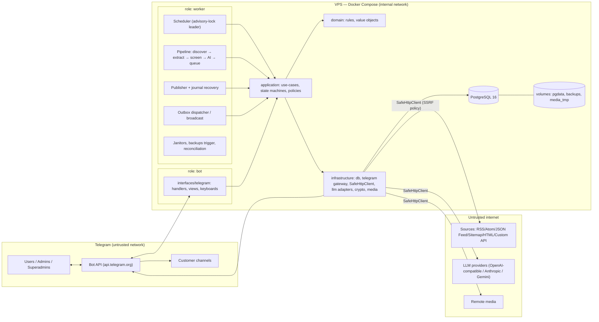

# Target Blueprint (Stage B)

Status: proposed for operator approval · Depends on: ADR-0001…0014 · Inputs: Master Prompt, Phase 1 specification.

## 1. Context and goals
Re-architect the Telegram channel-automation SaaS as a **modular monolith on PostgreSQL** with durable state machines for money, publishing and notifications, preserving every capability in `docs/product/feature-inventory.md` and every action in `docs/product/ui-action-register.json`.

## 2. Target architecture



## 3. Trust boundaries
| # | Boundary | Untrusted side | Control |
|---|---|---|---|
| T1 | Telegram → bot | update payloads, callback data, user text/media | parse+validate, `Actor` resolution, policy checks, rate limits |
| T2 | VPS → internet | URLs from users/sources/AI endpoints | `SafeHttpClient` (IP policy, DNS pinning, redirect re-validation, size/time caps, header stripping) |
| T3 | Scraped content → LLM | article text, titles, URLs | untrusted-data envelope, structural output validation, score recomputation |
| T4 | LLM output → Telegram | generated markup | `RichAST` only, renderers escape; no raw HTML |
| T5 | Process → DB | any app role | least-privilege DB roles (`app_rw`, `migrator`, `backup_ro`), constraints as last line of defence |
| T6 | Host → container | operator host | non-root, read-only FS, no secrets in image, `.env` mode 600 |
| T7 | Operator → deploy | scripts | serialized, digest-pinned, verified backup first |

## 4. Component ownership (Stage D modules → code, tables, jobs)
| Module | Code package (`application/…`) | Owns tables | Background |
|---|---|---|---|
| Identity & roles, membership gate | `identity` | `users`, `audit_log` | — |
| Plans & entitlements, usage/quotas | `plans`, `entitlements` | `plans`, `usage_counters`, `plan_changes` | plan-expiry transition job |
| Payments, discounts, wallet, referral | `billing` | `payments`, `discounts`, `discount_redemptions`, `wallet_balances`, `ledger_entries`, `referrals` | payment recovery, reconciliation |
| Channels & ownership | `channels` | `channels`, `channel_transfer_tokens` | — |
| Sources & discovery | `sources`, `discovery` | `sources`, `source_fetch_state` | discovery jobs |
| Article processing | `articles` | `articles`, `published_items` | extract/screen/AI jobs |
| AI routing | `ai` | `ai_models`, `ai_cache`, `ai_usage` | probes, breaker recovery |
| Media | `media` | — (temp files) | janitor |
| Queue/review & publishing | `queue`, `publishing` | `publication_journal`, `deep_links` | publisher, journal recovery |
| Support | `support` | `support_sessions`, `support_routes` | — |
| Localization | `i18n` | `text_overrides` | — |
| Notifications & broadcast | `notifications` | `outbox`, `broadcasts` | dispatcher |
| Superadmin control & health | `admin`, `health` | `settings`, `alerts`, `system_heartbeats`, `jobs` | alert evaluator |
| UI | `interfaces/telegram` | `input_sessions`, `rate_limits` | — |

## 5. Data ownership rules
One module writes each table; others read through the owner's query port. Cross-module effects occur through use-case orchestration in one transaction or through the outbox/jobs.

## 6. State machines (authoritative)
- **Article:** `discovered → extracted → {rejected_* | ai_pending} → ai_processing → {ready | ai_retryable | ai_exhausted | rejected_*}`; `ready → publishing → {published | delivery_unknown | ready(on safe failure)}`. Infrastructure failures never map to `rejected_*`.
- **Publication journal:** `reserved → in_flight → acknowledged → settled`; side exits `failed_safe`, `delivery_unknown`.
- **Payment:** `pending → processing → approved → refunded`; `pending → rejected`; `processing` has a lease.
- **Outbox/jobs:** `pending → sending/running → sent/done | retry | dead_letter/failed`.
- **Channel transfer token:** `issued → consumed | expired | locked`.

## 7. Sequence — payment approval
```mermaid
sequenceDiagram
  autonumber
  actor SA as Superadmin
  participant UI as bot/UI
  participant UC as ApprovePayment (use-case)
  participant DB as PostgreSQL (1 txn)
  participant OB as Outbox
  SA->>UI: s:pay_ok:{id} (confirm)
  UI->>UC: approve(actor, payment_id)
  UC->>UC: policy.require_superadmin(actor)
  UC->>DB: BEGIN
  UC->>DB: UPDATE payments SET status='processing', lease... WHERE id=:id AND status='pending' RETURNING *
  alt 0 rows
    DB-->>UC: already handled
    UC-->>UI: AlreadyProcessed (no side effects)
  else claimed
    UC->>DB: SELECT wallet FOR UPDATE; re-quote plan price + wallet + discount (live)
    UC->>DB: discount UPDATE … WHERE used<max RETURNING (abort on 0 rows)
    UC->>DB: ledger_entries INSERT (idem key) + wallet_balances UPDATE
    UC->>DB: apply entitlement (assign/renew/upgrade) + plan_changes INSERT (idem key)
    UC->>DB: referral reward INSERT (idem key payment_id, capped per currency)
    UC->>DB: payments SET status='approved', approved_by, applied_at
    UC->>OB: INSERT outbox rows (customer, referrer, superadmins)
    UC->>DB: COMMIT
    UC-->>UI: Approved
    OB-->>SA: dispatcher delivers (retry/backoff, dead-letter)
  end
```
Quote drift (price/wallet/discount changed) aborts to `pending` with a reason shown to the superadmin; nothing is half-applied.

## 8. Sequence — publication
```mermaid
sequenceDiagram
  autonumber
  participant SCH as Scheduler (leader)
  participant PL as Pipeline job
  participant AI as AI router
  participant PB as Publisher
  participant DB as PostgreSQL
  participant TG as Telegram gateway
  SCH->>DB: pick due channels (fair, capped), enqueue cycle jobs
  PL->>PL: discover → extract → date/dedupe/ad-screen
  PL->>AI: transform (budget, cache, fallback, breaker)
  AI-->>PL: ContentResult v1 (validated, score recomputed)
  PL->>DB: article = ready (or rejected_* / ai_retryable)
  SCH->>PB: publish(article) [auto] or admin a:pub [manual]
  PB->>DB: txn: reserve quota + journal(reserved→in_flight) + article=publishing
  PB->>TG: send (native rich → html → plain fallback chain)
  alt confirmed
    TG-->>PB: message_id
    PB->>DB: txn: journal=acknowledged → settle: published_items + article=published + deep_link
  else definite failure before send
    PB->>DB: journal=failed_safe, release quota, article=ready/retry
  else timeout after bytes sent / process crash
    PB->>DB: journal=delivery_unknown (no auto-resend; admin sees distinct state)
  end
  Note over PB,DB: startup/periodic recovery settles acknowledged, marks orphan in_flight as delivery_unknown
```

## 9. Operational model
Three Compose services + one-shot migrate; leader election; graceful drain; health semantics per ADR-0011; backups and rollback per ADR-0012.

## 10. Performance and resource targets (to be *measured* in Phase 9; reference profile assumed until operator confirms — OI-5)
Reference profile: 1 VPS, 2 vCPU / 2 GB RAM, ≤ 300 channels, ≤ 3 000 sources, ≤ 50 000 users, ≤ 2 000 posts/day.
| Metric | Target |
|---|---|
| RSS per role at idle / under load | ≤ 200 MB / ≤ 350 MB |
| PostgreSQL RSS (tuned) | ≤ 400 MB |
| Time to ready after start | ≤ 20 s (excluding DB cold start) |
| Graceful shutdown | ≤ configured grace (default 30 s), zero lost in-flight |
| Callback → first edit (p95, no external calls) | ≤ 300 ms server-side |
| Job claim throughput | ≥ 200 jobs/s sustained |
| Outbox drain | ≥ Telegram limit (~25 msg/s global) without starving interactive traffic |
| Article extraction CPU | ≤ 150 ms p95 per typical article (process pool) |
| Scheduler tick overhead with 300 channels | ≤ 1 s |
Rust gate: only if profiling shows a target missed after optimisation (ADR-0001).

## 11. Risks → mitigations map
Each `RISK-*` in `current-risks.md` maps to a control in ADR-0004/5/7/8/9; the Phase 3–6 test plans reference them by id.

## 12. Open items requiring operator input (none blocks Phase 3)
| ID | Item | Needed by |
|---|---|---|
| OI-1 | Sanitised/full **copy of the legacy SQLite DB** (read-only) to validate the migration mapping | Phase 8 |
| OI-2 | Legacy encryption key (once, at migration time) or acceptance that keys must be re-entered | Phase 8 |
| OI-3 | Confirm refund policy in ADR-0004 §8 (full refund only, entitlement revoked, reward clawback) | Phase 4 |
| OI-4 | Superadmin initial id(s), bot token, supported VPS OS | Phase 3/8 |
| OI-5 | Target VPS size and expected scale (reference profile in §10) | Phase 9 (earlier if far larger) |
| OI-6 | Registry state of `sendRichMessage`: verified against **primary** Bot API docs in Phase 6 (research here is secondary-source only) | Phase 6 |

## 13. Phase impact
Phases 3–9 stay as agreed; Phase 3 starts with repo scaffolding, PostgreSQL test fixture (spike validated), Alembic baseline, settings/redaction/crypto, `SafeHttpClient`, jobs/outbox, health, CI.
